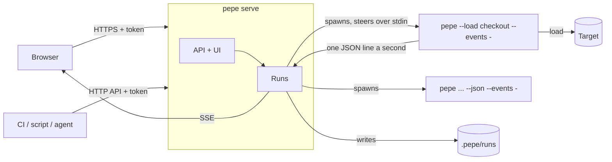

# `pepe serve`: pepe as a server

Status: the API is built, all three phases (docs/serve.md); the web UI is still to come · 2026-10-25

pepe today is a command: a person at a terminal, a CI job, or an agent
through `pepe mcp`. `pepe serve` makes the same binary a self-hosted
server with an HTTP API and a web UI, so a team can start, watch and
compare load tests from a browser or a script without installing pepe
everywhere, and without pepe becoming a different program.

## Goals

- Run, watch, steer and compare tests from a browser.
- The same over HTTP for CI, scripts and agents, returning the same JSON
  reports (`schema_version` 1) the CLI prints.
- Safe to leave running: it is a traffic generator that takes orders
  over the network, so it is locked down by default.
- One binary, no database, no JS toolchain, little added size.

## Not goals (for now)

- A hosted service (SaaS). Self-hosting fits the guardrails, and the
  Docker image already exists.
- Distributed load from several machines (phase 3).
- Accounts and roles beyond named tokens.

## What it builds on

| Already in pepe | Used for |
| --- | --- |
| `pepe slack serve`: a long-running listener that runs saved tests as `pepe --load NAME` children, under the directory's guardrails, steered over their stdin (`crate::control`) | The process model and steering, as is |
| `pepe mcp`: a request becomes a child `pepe` and its JSON report | The same mapping, over HTTP |
| `.pepe/tests` and `.pepe/runs` (`crate::store`) | Where tests and runs live; `pepe history` and `pepe compare` see the server's runs |
| `crate::html`: the report as one self-contained page | A finished run's page, unchanged |
| `config::hold`: every place's guardrails at once, the strictest winning | The server's flags, the project's `pepe.toml` and the request, together |
| `crate::compare`, `crate::schema` | `/api/compare`, `/api/schema` |

## How it works

### 1. Every run is a child process

The server never sends load itself. A run is `pepe --load NAME` or
`pepe ... --json` started as a child, exactly as the Slack listener does.

- A run that crashes, hangs or runs out of memory can't take the server
  down; the server kills it after its own deadline.
- Every guardrail and code path is the one the CLI uses; nothing is
  checked twice in two ways.
- Steering is the existing stdin protocol: `pause`, `resume`,
  `concurrency 40`, `stop`.

One addition to the run itself: **`--events -`** writes a JSON line a
second while the run goes (that second's timeline sample, the counts so
far, the verdict as it stands), then the final report as the last line.
The server relays them; a browser or a script reads them as Server-Sent
Events. It is useful on its own too (`pepe --events - ... | jq`).

### 2. The API

JSON in and out, a bearer token on every call.

| Call | Does |
| --- | --- |
| `POST /api/runs` `{"test": "checkout"}` or `{"url": ..., "requests": ..., ...}` | Starts a run; `202 {"id"}`. The body takes the keys of a `pepe.toml` |
| `POST /api/runs?dry_run=1` | The plan, nothing sent (`--dry-run --json`) |
| `GET /api/runs` | Runs going and recent |
| `GET /api/runs/:id` | Its state, and the final report once there is one |
| `GET /api/runs/:id/events` | SSE: a line a second, then the report |
| `GET /api/runs/:id/report.html` | The `crate::html` page |
| `POST /api/runs/:id/pause` · `/resume` · `/stop` | Steers it |
| `POST /api/runs/:id/concurrency` `{"n": 40}` | Held to `--max-concurrency` |
| `GET /api/tests` · `GET/PUT/DELETE /api/tests/:name` | The saved tests |
| `GET /api/tests/:name/runs` | Its recorded runs (`pepe history`) |
| `GET /api/compare?before=...&after=...` | `pepe compare --json` |
| `GET /api/schema/:kind` | `pepe schema` |

Status codes say what the CLI's exit codes say: a guardrail refusing a
run is `422` with the reason, a run that couldn't start `500`, too many
runs at once `429`.

### 3. The web UI

One static page compiled into the binary (`include_str!`): plain
JavaScript and SVG, no build step, nothing fetched from a CDN, light and
dark, mouse and keyboard, the same spirit as `crate::html` and the docs
site. Four screens, the terminal's:

- **Tests**: the library; run one, or open its history.
- **New run**: a form of the `pepe.toml` keys, the dry-run plan shown
  before Start, and Save as a test.
- **Live**: the throughput and p50/p99 curves, the verdict as it forms,
  pause, resume, concurrency and stop.
- **History**: a test's runs, any two compared.

A finished run is the existing report page.

### 4. Security

The server sends traffic wherever it is told, to whoever holds the
token. So:

- **Loopback by default.** It listens on `127.0.0.1:7878`; another
  address needs `--listen`.
- **A token on every call.** Generated at start and printed once, or
  given with `--token-file`. It is a header, never a cookie, so a page
  in the user's browser can't start a run (no CSRF). Named tokens in
  phase 2, for the audit log.
- **Guardrails required off loopback.** With `--listen` on any other
  address the server refuses to start without `--allow-host` and the
  `--max-requests`, `--max-rate` and `--max-concurrency` caps.
- **A request can only tighten.** The server's flags, the project's
  `pepe.toml` and the machine's settings hold every run
  (`config::hold`); a request's own guardrails can narrow them only.
- **One run at a time by default** (`--max-runs`), so two users can't add
  up past the caps; past it, `429`.
- **An audit log**: who started what, with which settings, and how it
  ended, as JSON lines in `.pepe/serve.log`.
- TLS is left to a reverse proxy in front; the docs say how.

### 5. Storage

Runs the server starts are recorded under `.pepe/runs/NAME/` like
`--record`, so the CLI sees them and the server sees the CLI's. Ad hoc
runs (a URL, not a test) go under `.pepe/runs/_adhoc/`. No database: the
store is files, committed or not, as today.

### 6. The HTTP stack

hyper's server, directly. hyper is in the tree already (reqwest is built
on it), so it costs little in binary size, and it does what an API with
streaming needs (keep-alive, chunked SSE, limits on heads and bodies).
The hand-made server in `exporter.rs` is right for one `/metrics` page
and wrong for this. A web framework (axum) would add more than it saves
at this size.

## Phases

1. **First PR**: `pepe serve` with the runs API, SSE, the token,
   loopback by default and the refusal off it, the audit log; `--events`
   on runs; the UI's Tests, New run and Live screens, and finished
   reports. The Docker image runs `pepe serve` when given no command.
2. Editing tests in the browser, History and Compare screens, ping and
   ramp live, named tokens.
3. Distributed load: `pepe worker --join https://server` agents in
   other regions take a share of one run, the server merging their
   reports. Scheduled runs. A worker holds a WebSocket it opened itself
   (`src/ws.rs` has both ends), because it is behind NAT and both sides
   talk at once; the browser and the API keep to SSE and POST.

## How to check it before building

1. **Prior art**: Locust's web UI, k6 and Gatling's front ends: what
   their users like and complain about.
2. **The two audiences**: a teammate given the four screens on paper
   ("what would you click first?"), and whoever runs CI or an agent given
   the API ("would this replace your `pepe --json` script?").
3. **Attack it**: can a page in a browser start a run? Can a request
   widen the guardrails? What happens on `0.0.0.0` with none? Can two
   users together pass the caps?
4. **A one-day spike** of what is uncertain: `--events` relayed as SSE
   (lag, a closed tab, a child that dies), stdin steering (how fast a
   stop lands), and the binary's size with hyper's server in it.

## Open questions

- **UI without a framework?** One static page keeps the repo free of a
  JS toolchain; React and a bundler would grow more easily.
- **Children, not threads?** A run inside the server would make live
  numbers simpler, but a bad run could take the server down and would
  bypass the CLI's guardrail path.
- **Port**: 7878, or one that says pepe?
